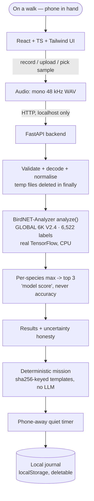

# BirdWalk 🌿 — hear one bird, then look up

**Powered by [BirdNET](https://birdnet.cornell.edu/)** — a nature-discovery
web app for the Hacktoberfest 2026 "Touch Grass" challenge. Record, upload,
or pick a bundled sample of bird audio; a **real pretrained BirdNET model
runs locally** on your machine, gives one honest clue, and hands you a
short phone-away mission to notice the living world around you.

> Hackathon demo, non-commercial educational use. See
> [Licences & attribution](#licences--attribution) and
> [Limitations & honest claims](#limitations--honest-claims).

## The problem & the person

You're on a walk in India (or anywhere). Your phone is in your hand,
screen down, and the soundscape is going unnoticed. BirdWalk is for the
person who *wants* to notice birds but doesn't have a field guide or an
ear trained yet. The app's goal is the **shortest** part of the
experience: one audio clue → one tiny mission → phone back away.

## How it works



Plain-text view of the same pipeline:

```
Browser (Vite + React + TS + Tailwind v4)
   ├─ record (MediaRecorder → converted to mono 48 kHz WAV in-page)
   ├─ upload (.wav/.mp3/.ogg/.flac ≤ 25 MB ≤ 60 s)
   └─ bundled sample clips (CC BY-SA 4.0, downloaded legally)
            │  HTTP (localhost only)
            ▼
FastAPI backend (Python, CPU)
   ├─ audio_service: validate + decode + normalise to mono WAV (temp,
   │                 deleted in `finally` — verified 0 leftovers)
   ├─ birdnet_service: official BirdNET-Analyzer `analyze()` —
   │                   BirdNET GLOBAL 6K V2.4, 6,522 labels, real
   │                   TensorFlow inference, per-species max, top 3
   ├─ mission_service: deterministic, safe missions (sha256-keyed
   │                   templates — no LLM, no network needed)
   └─ /api/india-species: Indian bird names verified against the
                          model's own label list (69/86 candidates)
            ▼
Results view → "model score" (never called accuracy) → mission →
phone-away quiet timer → local journal (localStorage, deletable)
```

### Screenshots

> _Pending — to be captured from a live local run and committed. No
> screenshots are shown here until they are real; nothing below is a
> mockup passed off as the running app._

| Landing & readiness | Sample → results (model score) | Mission & phone-away |
|---|---|---|
| _pending_ | _pending_ | _pending_ |

No audio is sent to any third-party service. No account, no database,
no GPS. The backend binds to `127.0.0.1` and CORS allows localhost dev
origins only; API docs endpoints are disabled.

## Quick start

Requirements: **Python ≥3.11** (built/tested on 3.12.3), **Node ≥20**
(tested on v26.2.0), ~1 GB free for the model's first download.

```bash
# 1. Backend (first use downloads the ~275 MB BirdNET model + base labels, once)
cd backend
python -m venv .venv
.venv\Scripts\activate            # Windows  (source .venv/bin/activate on POSIX)
pip install -r requirements.txt
uvicorn app.main:app --host 127.0.0.1 --port 8000

# 2. Frontend (separate terminal)
cd frontend
npm install
npm run dev                       # → http://localhost:5173

# 3. Optional: fetch the five demo samples (CC BY-SA 4.0, Wikimedia Commons)
python scripts\download_samples.py
```

Tests:

```bash
backend\.venv\Scripts\python.exe -m pytest -q          # 36 unit tests
backend\.venv\Scripts\python.exe -m pytest -q -m integration   # 3 real-inference tests
cd frontend && npm run build                           # tsc + vite
```

Regenerate the recorded real top-k outputs for the bundled samples
(writes the committed `data/model_outputs.json` evidence artifact):

```bash
backend\.venv\Scripts\python.exe scripts\record_sample_outputs.py
```

Rebuild the India shortlist from the model's own labels:

```bash
backend\.venv\Scripts\python.exe scripts\build_india_species_list.py
```

## Demo script (what to click)

1. Landing → "Local model ready" pill (it honestly shows *not loaded*
   until the first real inference completes).
2. **Samples** → pick *Asian Koel* → analysis runs on the real model →
   rank 1 **Asian Koel, model score 0.9748** (observed value, not a
   promise — see `TEST_REPORT.md`).
3. Results show the model's top clues, the "this is a model score, not
   accuracy" disclaimer, and — for samples — the source's own label
   clearly marked as an *uploader claim*.
4. Accept a **mission** (deterministic: same species → same mission,
   always) → **phone-away** screen with a quiet timer → tap done →
   entry lands in your local journal.
5. **Upload** any short `.wav/.mp3/.ogg/.flac` (or record with your mic
   — see limitations) to try your own audio.
6. **About** → live model/licence info + the searchable India shortlist
   verified against the model's actual label list.

## Offline & data scope (what is actually true)

- After the one-time model download, **inference runs entirely on this
  machine**: the analysis path makes no outbound network calls (model
  is served from the local cache) and temp audio is deleted in a
  `finally` block — verified by test runs with 0 leftover temp dirs.
  This is reported by `/api/model-info` as `runs_locally_after_setup: true`.
- A full disconnected-OS (airplane-mode) run has **not** been tested;
  `/api/model-info` reports `airplane_mode_verified: false` and the claim
  above is scoped to code paths and local-only binding — not a verified
  airplane-mode result.
- Phone-native (browser-on-phone) inference is **not** claimed — the
  model runs on the backend host.

## Limitations & honest claims

- **"Model score" ≠ accuracy.** Scores are raw classifier outputs; low
  scores and unknown audio produce a `no_reliable_detection` path —
  verified live with a synthetic birdless-noise probe (strongest score
  0.01, no bird invented). A sine tone once produced a 0.64 false
  positive — evidence that scores must not be over-trusted
  (`MODEL_CARD.md` keeps that record).
- **Sample clips are metadata smoke tests, not field validation.** The
  species labels come from the uploaders ("source claims") and were not
  independently verified. On the **production (normalised) pipeline all
  5 clips' top-1 prediction agreed with the uploader's label** — that is
  *label agreement*, **not** accuracy (verbatim top-3 in
  `data/model_outputs.json`; the raw pre-normalisation analyzer matched
  only 3/5, see `MODEL_CARD.md` §4). No personal field test was
  conducted by the builder, and no general model accuracy is claimed.
- **Microphone recording is implemented but NOT TESTED end-to-end on a
  physical device** in this build environment (automation can't grant
  a mic). Recordings are converted to WAV in-page because backends
  can't decode webm/opus; the conversion logic is verified, the device
  flow is not.
- **Gemma/Ollama generation is omitted, not faked** — no running local
  LLM was available, so missions use deterministic templates only.
- **BirdNET weights are CC BY-NC-SA 4.0 (non-commercial).** BirdWalk's
  own code is MIT; the model and sample audio keep their own terms. The
  app is not monetised and no weights/audio are redistributed here.
  **Open question, no legal conclusion drawn:** whether Hacktoberfest
  participation or prize money is a "non-commercial" use is not resolved
  in this repo — see `THIRD_PARTY_NOTICES.md`. Commercial reuse requires
  removing the model or licensing it from the BirdNET team.
- Not deployed anywhere; this is a local demo. Not tested on mobile
  browsers beyond viewport-styled CSS and 360 px layout checks.

## Licences & attribution

- **BirdNET** — model by K. Lisa Yang Center for Conservation
  Bioacoustics, Cornell Lab of Ornithology & Chemnitz University of
  Technology. Analyzer code MIT; model weights **CC BY-NC-SA 4.0**.
  Details: `MODEL_CARD.md`, `THIRD_PARTY_NOTICES.md`.
- **Sample audio** — five CC BY-SA 4.0 recordings from Wikimedia
  Commons (Indian Robin by Sharadapte; Red-whiskered Bulbul ×2; Asian
  Koel ×2), each with creator, source page, and checksum in
  `data/samples/manifest.json`; audio files are gitignored and
  reproducible via `scripts/download_samples.py`.
- Frontend dependencies and their licences: `THIRD_PARTY_NOTICES.md`.

## Repository map

| Path | What |
|---|---|
| `frontend/` | Vite + React 19 + TS + Tailwind v4 app |
| `backend/` | FastAPI service + `tests/` (pytest) |
| `scripts/` | sample downloader, model smoke test, real top-k recorder (`record_sample_outputs.py`), India list builder, negative-path probe |
| `data/samples/` | manifest + README (audio gitignored) |
| `data/model_outputs.json` | committed record of real top-3 model outputs on the 5 samples (evidence) |
| `MODEL_CARD.md` | model facts, licences, observed outputs |
| `TEST_REPORT.md` | measured test evidence + NOT TESTED list |
| `IMPLEMENTATION_STATUS.md` | phase-by-phase build log |
| `THIRD_PARTY_NOTICES.md` | dependency attributions |
| `CONTEXT.md` / `ALIGNMENT.md` / `SKILLS.md` / `BUILD_PROMPTS.md` | challenge brief & build plan |

## GitHub metadata (suggestions for the repo settings)

- **Description:** "BirdWalk — identify a bird from audio with a local
  BirdNET model, then get a screen-free phone-away mission. React +
  FastAPI + BirdNET, Hacktoberfest 2026."
- **Topics:** `hacktoberfest`, `birdnet`, `bird-song`, `audio-classification`,
  `fastapi`, `react`, `vite`, `tailwindcss`, `local-inference`, `touch-grass`,
  `conservation-bioacoustics`.
- **Website / live demo:** none — this is a local demo; do **not** add a
  live URL until one is actually deployed.
- **Social preview:** a real screenshot once the pending screenshots above
  are captured (no mockups).

Made for **Hacktoberfest 2026 — "Touch Grass"**. Go outside. 🌳
